<!-- Hero Banner: Fluid Waving Dark Gradient -->

<!-- Real-time Animated Typing Terminal Subtitle -->

  

<!-- Sleek Dark Mode Badges -->

 

### 🎃 Hacktoberfest & Open Source

| Initiative | Achievement / Contribution | Tech Stack | Quick Links |
| :--- | :--- | :--- | :--- |
| 🎃 **Kestra** | Engineered automated dependency health-check blueprints for **Go** (`go.mod`), **Python** (`requirements.txt`), and **Node.js** (`package.json`) via official package registries. | `Kestra` `Go` `Python` `Node.js` | [PRs & Blueprint](https://github.com/kestra-io/blueprints/pulls?q=author%3ASankalpPandey-56) |
| 🎃 **Beyond-2D** | Built an AI-driven spatial pipeline converting 2D architectural floor plans into interactive 3D visualizations using Gemma 4, Three.js, and Next.js. | `Gemma 4` `Three.js` `Next.js` | [🚀 Live Demo](https://beyond-2-d.vercel.app) · [Repository](https://github.com/SankalpPandey-56/Beyond-2D) |
| ⚡ **Supabase** | Fixed realtime broadcast payload filter transforms preventing runtime client exceptions. | `TypeScript` `Realtime` | [PR #2802](https://github.com/supabase/supabase-js/pull/2802) |
| ⚡ **PyPA Twine** | Optimized package batch release publishing pipeline in official Python packaging tool. | `Python` `Packaging` | [PR #1408](https://github.com/pypa/twine/pull/1408) |

 

### 🛠️ Featured Engineering Projects

| Project | Focus | Description | Stack | Link |
| :--- | :--- | :--- | :--- | :--- |
| [**termlens**](https://github.com/SankalpPandey-56/termlens) | *Systems & TUI* | Headless end-to-end testing engine for CLI and TUI apps with real pseudo-terminals (PTYs), rendered-screen assertions, and diffing. | `Rust` `Unix PTY` `CLI` | [View Repo ➔](https://github.com/SankalpPandey-56/termlens) |
| [**squidbrake**](https://github.com/SankalpPandey-56/squidbrake) | *AI Governance* | Safety & human-in-the-loop change control for autonomous AI agents with tamper-evident audit logging. | `Python` `AI Safety` `Audit` | [View Repo ➔](https://github.com/SankalpPandey-56/squidbrake) |
| [**lidtap**](https://github.com/SankalpPandey-56/lidtap) | *Hardware Hacking* | macOS menu bar utility transforming laptop display lid taps into programmable physical buttons via accelerometer sensors. | `Swift` `macOS` `Hardware` | [View Repo ➔](https://github.com/SankalpPandey-56/lidtap) |
| [**Git-Mastery**](https://github.com/SankalpPandey-56/Git-Mastery) | *Developer Tools* | Interactive terminal-based gamified environment to master Git branching, rebasing, and internals. | `Interactive CLI` `Git` | [View Repo ➔](https://github.com/SankalpPandey-56/Git-Mastery) |

 

### 💻 Systems & Tech Stack

  

 

### 🔥 Activity Streak

<!-- Live Neon Streak Dashboard -->

 

### 💡 Systems Insight

<!-- START_SECTION:daily_tip -->
> **💡 Systems Tip of the Day:** Git commits are immutable snapshots of your repository tree identified by cryptographic hashes, not file diffs.
<!-- END_SECTION:daily_tip -->

 

### ⚡ Live PR Telemetry

<!-- START_SECTION:pr_telemetry -->

   

| Rank | Target Repository | Merged PRs | Focus / Ecosystem |
| :---: | :--- | :---: | :--- |
| 🥇 | [**batrapulkit/squidbrake**](https://github.com/batrapulkit/squidbrake) | `7 merged` | AI agent change control, human-in-the-loop governance & audit trails |
| 🥈 | [**FROWNINGdev/orm-lens**](https://github.com/FROWNINGdev/orm-lens) | `3 merged` | Automated migration risk analysis & schema intelligence for ORMs |
| 🥉 | [**SankalpPandey-56/Beyond-2D**](https://github.com/SankalpPandey-56/Beyond-2D) | `2 merged` | AI spatial engine converting 2D floor plans into interactive 3D |

| PR | Target Repository | Merged Contribution | Shipped Date |
| :---: | :--- | :--- | :---: |
| [**#250**](https://github.com/batrapulkit/squidbrake/pull/250) | [`batrapulkit/squidbrake`](https://github.com/batrapulkit/squidbrake) | Command reader: classify railway down and gh repo archive as irreversible | `Nov 19, 2026` |
| [**#66**](https://github.com/kestra-io/libs/pull/66) | [`kestra-io/libs`](https://github.com/kestra-io/libs) | fix(python): validate metric types and tags, flush on send, and fix callable timer | `Nov 18, 2026` |
| [**#283**](https://github.com/FROWNINGdev/orm-lens/pull/283) | [`FROWNINGdev/orm-lens`](https://github.com/FROWNINGdev/orm-lens) | fix(migration-risk): treat annotated or partly computed dependencies as unknown | `Nov 17, 2026` |
| [**#1**](https://github.com/SankalpPandey-56/Beyond-2D/pull/1) | [`SankalpPandey-56/Beyond-2D`](https://github.com/SankalpPandey-56/Beyond-2D) | feat: 10 Curated Architectural Presets, Split-Screen Slider, and UI Redesign | `Nov 16, 2026` |
| [**#2**](https://github.com/SankalpPandey-56/Beyond-2D/pull/2) | [`SankalpPandey-56/Beyond-2D`](https://github.com/SankalpPandey-56/Beyond-2D) | feat: Light-Mode Studio, Day & Night Visualization System, 2D/3D Comparison Worksp... | `Nov 16, 2026` |

<!-- END_SECTION:pr_telemetry -->

 

### 📈 Contribution Stream

<!-- Animated Snake eating the contribution dots -->
<picture>
  <source media="(prefers-color-scheme: dark)" srcset="./github-contribution-grid-snake-dark.svg" />
  <source media="(prefers-color-scheme: light)" srcset="./github-contribution-grid-snake.svg" />
  
</picture>

  

<!-- Daily Heatmap Chart -->

 
<i>Telemetry, snake animation, and insights auto-updated and committed daily via GitHub Actions</i>

