<div align="center">

<h1><code>> sankalp.dev ~ whoami</code></h1>

<p>
  <b>Systems Developer & Open-Source Contributor</b><br>
  Building low-level tooling, AI agent controls, and experimental interfaces.
</p>

<!-- Social & Contact Badges -->
<a href="https://sankalppandey-56.github.io/builtbysankalp/#top"></a>
<a href="https://github.com/SankalpPandey-56"></a>
<a href="https://www.linkedin.com/in/sankalp-pandey-20361b41a/"></a>
<a href="https://www.instagram.com/uhm.sankalp"></a>

</div>

<br>

### <code>sankalp@github ~ $ ./hacktoberfest-achievements.sh</code>

| Initiative | Achievement / Contribution | Tech Stack |
| :--- | :--- | :--- |
| 🎃 **[Kestra](https://github.com/kestra-io/blueprints)** | Engineered automated dependency health-check blueprints for **Go** (`go.mod`), **Python** (`requirements.txt`), and **Node.js** (`package.json`) via official package registries. | `Kestra` `Go` `Python` `Node.js` |
| 🎃 **[Beyond-2D](https://github.com/SankalpPandey-56/Beyond-2D)** | Built an AI-driven spatial pipeline converting 2D architectural floor plans into interactive 3D visualizations using Gemma 4, Three.js, and Next.js. ([Live Demo](https://beyond-2-d.vercel.app)) | `Gemma 4` `Three.js` `Next.js` |
| ⚡ **[Supabase](https://github.com/supabase/supabase-js)** | Fixed realtime broadcast payload filter transforms preventing runtime client exceptions. | `TypeScript` `Realtime` |
| ⚡ **[PyPA Twine](https://github.com/pypa/twine)** | Optimized package batch release publishing pipeline in official Python packaging tool. | `Python` `Packaging` |

<br>

### <code>sankalp@github ~ $ ./featured-projects.sh</code>

| Project | Focus | Description | Stack |
| :--- | :--- | :--- | :--- |
| [**termlens**](https://github.com/SankalpPandey-56/termlens) | *Systems & TUI* | Headless end-to-end testing engine for CLI and TUI apps with real pseudo-terminals (PTYs), rendered-screen assertions, and diffing. | `Rust` `Unix PTY` `CLI` |
| [**squidbrake**](https://github.com/SankalpPandey-56/squidbrake) | *AI Governance* | Safety & human-in-the-loop change control for autonomous AI agents with tamper-evident audit logging. | `Python` `AI Safety` `Audit` |
| [**lidtap**](https://github.com/SankalpPandey-56/lidtap) | *Hardware Hacking* | macOS menu bar utility transforming laptop display lid taps into programmable physical buttons via accelerometer sensors. | `Swift` `macOS` `Hardware` |
| [**Git-Mastery**](https://github.com/SankalpPandey-56/Git-Mastery) | *Developer Tools* | Interactive terminal-based gamified environment to master Git branching, rebasing, and internals. | `Interactive CLI` `Git` |

<br>

### <code>sankalp@github ~ $ ./stack.sh --summary</code>

```text
├── Languages        :: Rust, Python, TypeScript, JavaScript, C/C++, Swift, Bash
├── Systems & Core   :: Unix PTYs, OS Motion Sensors, Docker, Git Internals, CI/CD Workflows
├── Web & Graphics   :: Next.js, React, Three.js, Tailwind CSS
├── Orchestration    :: Kestra, Event-Driven Pipelines, Agentic Workflows
└── Databases & AI   :: PostgreSQL, Supabase, Gemma / Local LLMs, Vector Search
```

<br>

### <code>sankalp@github ~ $ ./daily-insight.sh</code>

<!-- START_SECTION:daily_tip -->
> **💡 Systems Tip of the Day:** Accelerometers in modern MacBooks can be queried via low-level I/O Kit frameworks, turning physical lid taps into input triggers.
<!-- END_SECTION:daily_tip -->

<br>

### <code>sankalp@github ~ $ ./recent-activity.sh --limit 5</code>

<!-- START_SECTION:recent_activity -->
- PR merged on [**batrapulkit/squidbrake**](https://github.com/batrapulkit/squidbrake): [](https://github.com/batrapulkit/squidbrake)
- PR opened on [**S-AI-Projects/Data-Science-For-Beginners**](https://github.com/S-AI-Projects/Data-Science-For-Beginners): [](https://github.com/S-AI-Projects/Data-Science-For-Beginners)
- Pushed commits to [**SankalpPandey-56/termlens**](https://github.com/SankalpPandey-56/termlens)
- PR merged on [**vyncint/termlens**](https://github.com/vyncint/termlens): [](https://github.com/vyncint/termlens)
- Pushed commits to [**SankalpPandey-56/squidbrake**](https://github.com/SankalpPandey-56/squidbrake)
<!-- END_SECTION:recent_activity -->

<br>

<div align="center">

### <code>sankalp@github ~ $ ./contributions.sh --stream</code>

<!-- Animated Snake eating the contribution dots -->
<picture>
  <source media="(prefers-color-scheme: dark)" srcset="./github-contribution-grid-snake-dark.svg" />
  <source media="(prefers-color-scheme: light)" srcset="./github-contribution-grid-snake.svg" />
  
</picture>

<br><br>

<!-- Daily Heatmap Chart -->


<br>
<sub><i>Telemetry, snake animation, and insights auto-updated and committed daily via GitHub Actions</i></sub>

</div>
